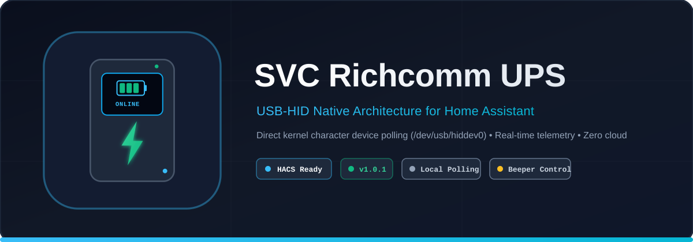

<p align="center">
  
</p>

# SVC / Richcomm Technologies UPS — Modern Driver & Integration Suite

[](https://hacs.xyz/)
[](https://www.home-assistant.io/)
[](https://www.python.org/)
[](LICENSE)

**Repository URL**: `https://github.com/Sc0rpion/Richcomm-UPS-Monitoring`  
**Languages**: [English](README.md) | [Русский](README.ru.md)

---

## 📌 Table of Contents
1. [Overview](#1-overview)
2. [HACS Installation (Home Assistant)](#2-hacs-installation-home-assistant)
3. [Repository Structure](#3-repository-structure)
4. [Hardware & Data Exchange Architecture](#4-hardware--data-exchange-architecture)
   - [Kernel & USB-HID Layer (`hiddev`)](#41-kernel--usb-hid-layer-hiddev)
   - [Richcomm FRAMED 0xA0 Protocol](#42-richcomm-framed-0xa0-protocol)
   - [Incoming UART Packet Reception](#43-incoming-uart-packet-reception)
   - [Megatec Protocol Specification](#44-megatec-protocol-specification)
   - [Beeper Stabilization Algorithm](#45-beeper-stabilization-algorithm)
   - [Binary BCD Fallback Protocol](#46-binary-bcd-fallback-protocol)
5. [Legacy Driver Analysis & Historical Bugs](#5-legacy-driver-analysis--historical-bugs)
   - [Historical Context (GCC 3.2.2 / Red Hat 8/9 / glibc 2.3.2)](#51-historical-context)
   - [SysV IPC Shared Memory (Key 0x1B56, 224 Bytes)](#52-sysv-ipc-shared-memory-key-0x1b56)
   - [Binary Configuration File `TimeCfg.conf` (52 Bytes)](#53-binary-configuration-file-timecfgconf)
   - [Dissected Bugs in the Original C Code](#54-dissected-bugs-in-the-original-c-code)
6. [Deep Dive: The Recompiled Daemon (`ups_monitor.py`)](#6-deep-dive-the-recompiled-daemon-ups_monitorpy)
   - [100% Binary & Memory Compatibility](#61-100-binary--memory-compatibility)
   - [Class Architecture & Transports](#62-class-architecture--transports)
   - [Virtual PTY UPS Simulator (`MegatecSimulator`)](#63-virtual-pty-ups-simulator-megatecsimulator)
   - [Automated Test Suite (`selftest`)](#64-automated-test-suite-selftest)
7. [Directory Guides](#7-directory-guides)
   - [`standalone/` (Pure Python CLI & Daemon)](#71-standalone-directory)
   - [`custom_components/svc_ups/` (Native Home Assistant)](#72-home-assistant-integration)
   - [`recompiled/` (ELF32 Reconstructed Daemon)](#73-recompiled-directory)

---

## 1. Overview

UPS units manufactured by **SVC** (as well as select models from PowerCom, Trust, Ippon, and Mustek using **Richcomm Technologies** chips, VID `0x0925`, PID `0x1234`) utilize a proprietary USB-to-UART bridge.

The legacy Linux software bundle (`ups_monitor`, `ups_status`, `ups_manager`, `ups_config`) was built in 2002–2003 for 32-bit x86 systems (glibc 2.3.2). On modern 64-bit systems (Debian 11/12, Ubuntu 20.04/22.04/24.04, Alpine, Home Assistant OS, Synology DSM, Proxmox), this software fails to execute (`Exec format error` / missing 32-bit runtime), suffers from segmentation faults, or deadlocks on `/dev/usb/hiddev0`.

This repository provides a complete, modern replacement:
1. **Native Home Assistant Integration (HACS Compliant)**: Direct GUI integration with auto-updates, dynamic hardware identity retrieval (`I\r`), and a stabilized Mute switch.
2. **Standalone Pure Python CLI & Daemon (`standalone/upstest.py`)**: Zero external dependencies (Python stdlib only), JSON telemetry export, background daemon, and hardware diagnostics.
3. **Reconstructed Legacy Daemon (`recompiled/ups_monitor.py`)**: 100% structure-compatible Python reimplementation of the disassembled ELF32 binary with SysV Shared Memory (`0x1B56`), `TimeCfg.conf` support, and a built-in virtual PTY simulator.

---

## 2. HACS Installation (Home Assistant)

This repository is **fully compliant** with HACS integration guidelines:

1. Open **HACS** in your Home Assistant sidebar.
2. Navigate to **Integrations**.
3. In the top right corner, click the three dots (**⋮**) &rarr; **Custom repositories**.
4. In the **Repository** field, paste:
   ```text
   https://github.com/Sc0rpion/Richcomm-UPS-Monitoring
   ```
5. In the **Type** dropdown, select **Integration**.
6. Click **Add**, find **SVC Richcomm UPS**, and click **Download**.
7. Restart Home Assistant.
8. Go to **Settings &rarr; Devices & Services &rarr; Add Integration &rarr; Search "SVC Richcomm UPS"**.

---

## 3. Repository Structure

```text
.
├── custom_components/svc_ups/         <-- Root HACS integration folder
│   ├── manifest.json                  <-- Domain 'svc_ups', version '1.1.0'
│   ├── driver.py                      <-- Raw hiddev driver (zero external pip packages)
│   ├── coordinator.py                 <-- Polling coordinator + hardware identity cache
│   ├── sensor.py                      <-- Voltages, battery %, load %, freq, model, FW sensors
│   ├── binary_sensor.py               <-- AC power, battery low, AVR, problem, test sensors
│   ├── switch.py                      <-- Stabilized beeper toggle switch (Q\r)
│   ├── button.py                      <-- Battery self-test & cancel buttons (T\r, CT\r)
│   └── config_flow.py                 <-- Web UI configuration wizard
│
├── hacs.json                          <-- Root HACS metadata (render_readme, homeassistant min version)
├── info.md                            <-- HACS store presentation card (English)
├── README.md                          <-- Master documentation (English)
├── README.ru.md                       <-- Master documentation (Russian)
│
├── standalone/                        <-- Pure Python standalone suite
│   ├── upstest.py                     <-- Single-file CLI, daemon, test suite, and JSON exporter
│   ├── README.md                      <-- Standalone CLI guide (English)
│   └── README.ru.md                   <-- Standalone CLI guide (Russian)
│
├── recompiled/                        <-- Disassembled ELF32 replacement
│   ├── ups_monitor.py                 <-- Reconstructed daemon (SysV SHM, TimeCfg, PTY simulator)
│   ├── README.md                      <-- Reverse engineering technical report (English)
│   └── README.ru.md                   <-- Reverse engineering technical report (Russian)
│
└── ha/                                <-- Remote bridge files (Synology / Proxmox)
    ├── docker-compose.yml             <-- Docker container for remote USB hosts
    └── mqtt_bridge.py                 <-- Standalone MQTT Auto-Discovery bridge
```

---

## 4. Hardware & Data Exchange Architecture

### 4.1. Kernel & USB-HID Layer (`hiddev`)
The Richcomm USB controller presents itself to Linux as a USB HID device rather than a virtual serial device:
* **Device nodes**: `/dev/usb/hiddev0` through `/dev/usb/hiddev15` (major `180`, minor `96 + i`).
* **Kernel ioctls used**:
  - `HIDIOCGDEVINFO (0x801C4803)`: Queries `struct hiddev_devinfo` to match Vendor ID `0x0925` and Product ID `0x1234`.
  - `HIDIOCGUCODE (0xC018480D)` / `HIDIOCGUSAGE (0xC018480B)`: Binds report descriptors.
  - `HIDIOCSUSAGE (0x4018480C)`: Sets individual usage report values.
  - `HIDIOCSREPORT (0x400C4808)`: Transmits an output feature report (`SET_REPORT`).

> **Signed 32-bit Sign Extension**:  
> In Linux kernel ioctl calls, usage values are passed as `signed int32`. Passing unsigned byte values greater than 127 (`0x80`..`0xFF`) results in `EINVAL` unless explicitly sign-extended (`val - 256` if `val > 127`).

#### Baud Rate Initialization (`SetBaud`)
To initialize the internal UART to **2400 baud**, the driver transmits a 4-byte feature report PDU:
$$\text{Divider} = \frac{500000}{\text{Baud}} = \frac{500000}{2400} \approx 208 = \text{0xD0}$$
$$\mathbf{PDU}_{\text{SetBaud}} = [\, 0\text{x80} \,,\; 0\text{xD0} \,,\; 0\text{x00} \,,\; 0\text{x00} \,]$$

---

### 4.2. Richcomm FRAMED 0xA0 Protocol
Raw text sent directly to `/dev/usb/hiddev` is rejected. The controller requires command bytes to be framed into 4-byte PDUs:
1. Data is segmented into chunks of **at most 3 bytes**.
2. Each chunk is framed into a 4-byte PDU:
   $$\mathbf{PDU} = [\, (0\text{xA0} \mid \text{Length}) \,,\; \text{byte}_0 \,,\; \text{byte}_1 \,,\; \text{byte}_2 \,]$$
   where unneeded trailing bytes are padded with `0x00`.
3. An inter-chunk delay is enforced:
   $$T_{\text{pause}} = \text{Length} \times \frac{11000}{\text{Baud}}\;\text{ms} \approx \text{Length} \times 4.58\;\text{ms}$$

| Command | ASCII | Bytes (Hex) | Framed PDU |
|---|---|---|---|
| Query Status | `Q1\r` | `51 31 0D` (len 3) | `[0xA3, 0x51, 0x31, 0x0D]` |
| Query Identity | `I\r` | `49 0D` (len 2) | `[0xA2, 0x49, 0x0D, 0x00]` |
| Toggle Beeper | `Q\r` | `51 0D` (len 2) | `[0xA2, 0x51, 0x0D, 0x00]` |
| Self-Test (10s) | `T\r` | `54 0D` (len 2) | `[0xA2, 0x54, 0x0D, 0x00]` |
| Cancel Self-Test | `CT\r` | `43 54 0D` (len 3) | `[0xA3, 0x43, 0x54, 0x0D]` |

---

### 4.3. Incoming UART Packet Reception
A background worker reads 8-byte events (`struct hiddev_event`) from the kernel:
* The report bytes are assembled into 6-byte packets `rep[0..5]`.
* If `rep[0] & 0x80 != 0`, it is a UART data frame. The payload length is $N = \min(\text{rep}[0] \ \& \ 7,\; 5)$, and bytes `rep[1 .. 1 + N]` are appended to the UART ring buffer.
* The upper bits of `rep[0]` contain the hardware status byte (e.g. `0xC0`):
  - Bit 7 (`0x80`): AC Utility 220V present (`Normal`).
  - Bit 6 (`0x40`): Battery healthy (`Normal`).

---

### 4.4. Megatec Protocol Specification

```
 Host PC                                  SVC Richcomm UPS
    │                                             │
    │ ── PDU [0x80, 0xD0, 0x00, 0x00] (SetBaud) ─> │  (Initialize 2400 baud)
    │                                             │
    │ ── PDU [0xA3, 'Q', '1', '\r'] (Query Q1) ──> │
    │ <─ '(231.0 000.0 232.0 010 49.0 13.7 ...' ──│  (47-byte status frame)
    │                                             │
    │ ── PDU [0xA2, 'I', '\r', 0x00] (Identity) ─> │
    │ <─ '#SVC            V-650-F-LCD V1.2       '─│  (Model & firmware version)
    │                                             │
    │ ── PDU [0xA2, 'Q', '\r', 0x00] (Beeper) ───> │  (Toggle beeper)
    │ <─ [350 ms settling delay for sound relay] ─│
    │ ── PDU [0xA3, 'Q', '1', '\r'] (Verify) ────> │
    │ <─ Bit b0 confirmed flipped ────────────────│
```

#### Status Inquiry: `Q1\r`
The UPS responds with a 47-character string:
```text
(MMM.M NNN.N PPP.P QQQ RR.R S.SS TT.T b7b6b5b4b3b2b1b0\r
```
* `MMM.M`: Input AC voltage (V, e.g. `231.0`).
* `NNN.N`: Fault reference voltage (V, e.g. `140.0`, ignored).
* `PPP.P`: Output AC voltage (V, e.g. `232.0`).
* `QQQ`: Power load percentage (0..100%, e.g. `010` = 10%).
* `RR.R`: Input frequency (Hz, e.g. `49.0`).
* `S.SS`: Battery voltage (V, e.g. `13.7` or `2.27` per cell).
* `TT.T`: Internal temperature (°C, e.g. `30.8`).
* `b7..b0`: Binary status bitmask:
  - **b7 (`0x80`)**: `1` = Utility Fail (running on battery), `0` = AC Normal.
  - **b6 (`0x40`)**: `1` = Battery Low.
  - **b5 (`0x20`)**: `1` = AVR Boost/Buck active.
  - **b4 (`0x10`)**: `1` = UPS Failed / Inverter error.
  - **b3 (`0x08`)**: UPS Type (`1` = Standby/Offline, `0` = Online).
  - **b2 (`0x04`)**: `1` = Battery self-test in progress.
  - **b1 (`0x02`)**: `1` = Timed shutdown active.
  - **b0 (`0x01`)**: `1` = Beeper **ON**; `0` = Silent mode (**OFF**).

#### Device Identity: `I\r`
Returns the hardware identification string:
```text
#Company_Name_ UPS_Model_ Version___\r
```
* Bytes 0..15: Manufacturer name (e.g. `SVC`).
* Bytes 16..26: Model (e.g. `V-650-F-LCD` or `Richcomm UPS`).
* Bytes 27..37: Firmware version (e.g. `V1.2`).

---

### 4.5. Beeper Stabilization Algorithm
The Megatec `Q\r` command is an **inverting toggle**, not an absolute state setter. In original drivers:
1. Blindly toggling when the user intended "Off" would turn the sound **On** if it was already muted.
2. The Richcomm microcontroller requires ~200–350 ms to latch its sound relay/EEPROM. Sending a subsequent `Q1\r` immediately resulted in UART packet collisions.

**Our stabilized implementation (`set_beeper`)**:
1. Checks the current sound bit `b0` via `Q1\r`.
2. If the current state already equals the desired target, **no command is sent**.
3. If different: clears the UART buffer, sends `Q\r`, and pauses **350 ms**.
4. Queries `Q1\r` to verify that bit `b0` has successfully changed.
5. Retries up to 3 times with serialized mutex protection (`_cmd_lock`).

---

### 4.6. Binary BCD Fallback Protocol
For select firmware revisions that use raw binary reports instead of ASCII text:
* Report 1: BCD-encoded input voltage and status byte.
* Report 2: BCD-encoded output voltage, line frequency, and power load.
* Report 3: BCD-encoded battery voltage and temperature.
* Report `0x11`: Timed shutdown.

The driver automatically falls back to binary parsing if Megatec ASCII responses are absent.

---

## 5. Legacy Driver Analysis & Historical Bugs

### 5.1. Historical Context
The vendor utilities (`ups_monitor`, `ups_status`, `ups_manager`, `ups_config`) were compiled with **GCC 3.2.2** on **Red Hat Linux 8.0/9.0** around 2002–2003 against **glibc 2.3.2 (i386)**. Modern 64-bit kernels and distributions lack 32-bit glibc libraries by default and employ stricter permissions on `/dev/usb/hiddev*`.

### 5.2. SysV IPC Shared Memory (Key `0x1B56`)
Inter-process communication between `ups_monitor` and GUI viewers used a 224-byte System V shared memory segment:
* Key: `0x1B56` (decimal `7000`).
* Semaphore: binary mutex using `SEM_UNDO`.
* Layout: `struct UPS_DATA_Status` (224 bytes, little-endian) containing cycle heartbeat, inbox commands (`cMesgTxt`), telemetry floats, and warning status flags.

### 5.3. Binary Configuration File `TimeCfg.conf`
Stored as a 52-byte binary struct (`struct TheCfgData`):
* Magic: `0x55AA0335`
* Delays: `ac_fail_delay`, `battery_low_delay`, `ups_failed_delay` (-1 = disabled).
* `warning_interval`, `turn_off_ups`, `turn_off_ups_time`, `com_port`, `comm_mode`.

### 5.4. Dissected Bugs in the Original C Code
1. **Status Bit Corruption**: In `Process_UPS_Cancel_warging`, the original code applied inverted bitmasks (`& 0xFE`, `& 0xFD`), inadvertently clearing unrelated status bits (such as the beeper and test flags) whenever mains AC power restored.
2. **Wild Memory Execution**: In `Shutdown()`, re-entry triggered `system(buffer)` on an uninitialized stack buffer.
3. **Swapped Function Names**: In the original source, `Quary_F` transmitted `I\r`, while `Quary_I` transmitted `F\r`.

---

## 6. Deep Dive: The Recompiled Daemon (`ups_monitor.py`)

Located in `recompiled/ups_monitor.py`, this file is a 100% faithful, bit-for-bit compatible reimplementation of the disassembled ELF32 binary.

### 6.1. 100% Binary & Memory Compatibility
* **SysV SHM via `ctypes`**: Communicates with original legacy binaries (`ups_status`, `ups_manager`) via key `0x1B56` without recompiling them.
* **`TimeCfg.conf` Parser**: Reads and writes the 52-byte binary configuration with strict magic validation.
* **Logging**: Recreates `PowerEventYYYYMM.log` and notification scripts (`./SendMSG.sh`, `./shutdown.sh`).

### 6.2. Class Architecture & Transports
* `SerialLink`: Raw termios 8N1 serial driver.
* `HiddevDevice` & `HidTextLink`: Framing `0xA0` over hiddev ioctls.
* `Monitor`: Finite state machine replicating `Start()`.

### 6.3. Virtual PTY UPS Simulator (`MegatecSimulator`)
Includes an in-memory virtual UPS using Linux pseudo-terminals (`pty`):
```bash
python3 recompiled/ups_monitor.py simulate
```
Emulates a 25-second power outage, countdown, and AC recovery for testing without physical hardware.

### 6.4. Automated Test Suite (`selftest`)
Executes 9 automated unit tests verifying struct packing, BCD conversions, Megatec parsers, SHM memory writes, and shutdown workflows:
```bash
python3 recompiled/ups_monitor.py selftest
```

---

## 7. Directory Guides

### 7.1. `standalone/` Directory
The `standalone/upstest.py` utility is the recommended CLI tool for servers and Docker containers:
* **One-shot status poll**: `python3 standalone/upstest.py`
* **Query model and firmware**: `python3 standalone/upstest.py --info`
* **Control beeper**: `python3 standalone/upstest.py --set-beeper off`
* **Battery self-test (10s)**: `python3 standalone/upstest.py --selftest`
* **JSON export**: `python3 standalone/upstest.py --json`
* **Background daemon**: `python3 standalone/upstest.py --daemon`

### 7.2. Home Assistant Integration
Located directly in `custom_components/svc_ups/`:
* Ready for 1-click addition as a HACS Custom Repository.
* Dynamically identifies manufacturer, model, and firmware from the hardware.
* Entities: 9 numerical sensors, 5 binary sensors, 1 switch (Mute), 2 control buttons.

### 7.3. `recompiled/` Directory
Contains `ups_monitor.py` for environments requiring backward compatibility with legacy SysV SHM tools and `TimeCfg.conf`.

---

## 8. License
This project is open-source under the **MIT License**.
